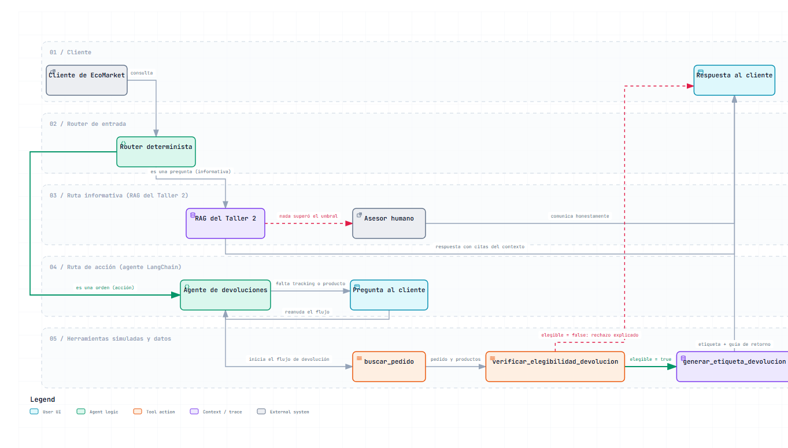

# Fase 1 — Diseño de la arquitectura del agente y sus herramientas

**Proyecto Final — IA Generativa.** Caso de estudio: EcoMarket (e-commerce de productos sostenibles).

La propuesta preliminar ([`propuesta-preliminar.md`](propuesta-preliminar.md)) planteó el objetivo, la justificación del problema y el enfoque; este documento es la formalización del diseño de la Fase 1: la arquitectura router, la definición de las herramientas y la justificación del marco de agentes, junto con el diagrama de flujo del proceso (planificación del flujo de trabajo).

---

## 1. Arquitectura: router + agente con herramientas (el RAG permanece como ruta alternan informativa)

La solución sigue la arquitectura router: la consulta del cliente entra a una capa de decisión con **reglas de entrada deterministas** (código, no un clasificador con IA) que la dirige a uno de dos subsistemas, y el RAG del Taller #2 permanece como la ruta alterna informativa:

- **Ruta informativa** (preguntas): el sistema RAG del Taller Práctico #2, completo y sin cambios — embeddings multilingües, base vectorial ChromaDB (coseno), umbral de pertinencia 0.55 con k=4 y escalamiento honesto cuando nada supera el umbral.
- **Ruta de acción** (órdenes): el agente de devoluciones con tres herramientas; es la única ruta que alcanza a las herramientas que escriben datos.

### 1.1 Por qué router y no "RAG como herramienta del agente"

| Criterio | Router (elegida) | RAG como herramienta del agente |
|---|---|---|
| **Determinismo** | Las consultas informativas conservan el pipeline ya calibrado del Taller #2 (umbral, k, escalado) sin depender de que el modelo decida bien llamar a la herramienta | La calidad depende de que el agente decida usar el RAG en cada consulta informativa: riesgo añadido en el flujo más frecuente |
| **Seguridad** | Las herramientas de acción solo son alcanzables por la ruta de devolución: un deseo mal inferido no puede escribir datos | El agente decide si toca las herramientas de acción en cualquier consulta: mayor superficie de riesgo |
| **Verificación** | Cada ruta se prueba por separado (los casos del Taller #2 se reutilizan) y la demo muestra ambas | Un solo agente multi-herramienta es más flexible pero más difícil de auditar caso a caso |

El router usa reglas explícitas (patrones que distinguen una orden de devolución en primera persona o imperativo — "quiero devolver...", "me llegó dañado..." — de una pregunta informativa — "¿cuál es el plazo...", "¿cómo solicito...?"). La decisión de enrutamiento es barata, auditable y reproducible; el discernimiento semántico (elegibilidad, explicación al cliente) queda donde corresponde: en las herramientas y en el modelo de lenguaje.

## 2. Diagrama de flujo del proceso de devolución

El flujo completo con las decisiones del router, las del agente y las llamadas a las herramientas (las cinco franjas son "carriles" que separan el trabajo de cada componente):

El diagrama anterior es la imagen estándarte de la figura; la versión interactiva (tema claro/oscuro, zoom, búsqueda, rastreo de relaciones, exportación a PNG/SVG) está en [`flujo-devolucion-agente.html`](flujo-devolucion-agente.html).

Lectura del flujo paso a paso:

1. **Cliente** — escribe su solicitud en lenguaje natural en la interfaz.
2. **Router determinista** (`src/agente.py`) — aplica las reglas de entrada: si es una pregunta, va a la ruta informativa; si es una orden de devolución, va al agente.
3. **Ruta informativa** — el RAG del Taller #2 responde con citas del contexto; si ningún fragmento supera el umbral de pertinencia, el caso escala honestamente al asesor humano.
4. **Ruta de acción** — el agente (LangChain 1.x, `create_agent`) inicia el flujo; si faltan el número de seguimiento, el producto o el motivo, pregunta al cliente en lugar de asumir, y reanuda el ciclo con el dato completo.
5. **Herramientas** (`src/herramientas.py`) — `buscar_pedido` (registro de pedidos, ECO-XXXXX) entrega el pedido y sus productos; `verificar_elegibilidad_devolucion` aplica el motor de reglas de la política y devuelve el dictamen; con `elegible = true` se llama a `generar_etiqueta_devolucion`, que revalida el dictamen, no duplica emisiones y persiste el registro auditable; con `elegible = false` el agente explica el rechazo citando la regla exacta y sus excepciones, sin generar etiqueta.

## 3. Herramientas del agente (mínimo exigido: dos sin contar el RAG; se definen tres)

| # | Herramienta | Entrada | Proceso (simulado sobre los datos del Taller #2) | Salida (contrato JSON) |
|---|---|---|---|---|
| 1 | `buscar_pedido` | `tracking` (ECO-XXXXX) | Búsqueda en el registro de pedidos (`data/pedidos.json`) | Pedido completo (productos, estado, fechas) o error explícito (`formato_invalido`, `pedido_no_encontrado`) con instrucción al agente |
| 2 | `verificar_elegibilidad_devolucion` | `tracking` + `producto` + `motivo` (texto libre) | Motor de reglas determinista que aplica la política real sobre el pedido, la categoría del producto (inventario) y el motivo clasificado | Dictamen estructurado `{elegible, regla_aplicable, detalle, dias_desde_entrega, tipo_motivo, ...}` o error de contrato |
| 3 | `generar_etiqueta_devolucion` | `tracking` + dictamen de elegibilidad | Revalida el dictamen, genera la etiqueta y persiste la emisión en `data/etiquetas_emitidas.json` (auditable) | `{numero_etiqueta, numero_guia, transportadora, direccion_recepcion, enlace_pdf_simulado}` o error (nunca emite con dictamen negativo) |

Cada herramienta recibe entradas validadas — falla con error explícito si el argumento es inválido — y produce salidas estructuradas que el agente usa para decidir el siguiente paso y que dejan registro auditable (requisito que alimenta la observabilidad de la Fase 3). Las reglas de negocio del dictamen están tabuladas en [`fase2-implementacion.md`](fase2-implementacion.md) (sección 2.2).

**Manejo de éxito y fallo previsto desde el diseño:** pedido inexistente o mal formateado (se pide el número de nuevo), producto no elegible (rechazo explicado con la regla exacta de la política, sin generar etiqueta), motivo ambiguo (se pregunta al cliente; no se asume), devolución ya en proceso (se comunica, no se duplica), y consulta fuera de dominio por la ruta informativa (escalamiento honesto ya implementado en el Taller #2).

## 4. Marco de agentes: LangChain (versión 1.x)

Criterios y su justificación:

- **Continuidad con el Taller #2:** todo el componente informativo ya está en LangChain (Chroma, `HuggingFaceEmbeddings`, `ChatOpenAI` con el endpoint OpenAI-compatible de Gemini). El agente reutiliza los mismos objetos y la misma clave API — no se introduce un segundo ecosistema.
- **Ajuste al flujo:** el ciclo requerido es exactamente el del marco: el modelo decide la herramienta y sus argumentos, el runtime ejecuta la función y devuelve al modelo el JSON estructurado hasta la respuesta final; `create_agent` (LangChain 1.x, el reemplazo moderno del par `create_tool_calling_agent`/`AgentExecutor` de 0.x) lo implementa directamente.
- **Descartes razonados:** LlamaIndex es fuerte en indexación, pero la base vectorial ya existe y reescribirla no aporta al problema. Los frameworks ligeros de orquestación (n8n, Activepieces) no entregan el control fino de contratos y auditoría que el enunciado pide demostrar en código.

---

*La implementación de esta arquitectura, sus contratos y sus casos de prueba están en [`fase2-implementacion.md`](fase2-implementacion.md).*